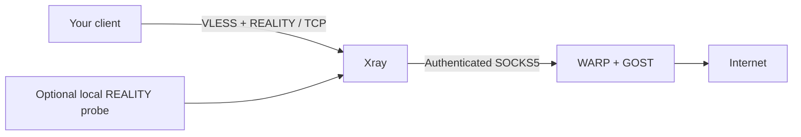

# VLESS + REALITY + WARP

A Docker Compose template for a private TCP proxy: Xray accepts VLESS with
REALITY and sends client traffic through an authenticated Cloudflare WARP
backend. Every installation generates its own credentials.



- Only the REALITY listener is public. WARP has no published host ports.
- Xray has no direct client-egress outbound. If the backend stops, client requests fail.
- Xray and the probe run without root, writable root filesystems, or capabilities.
- Images are pinned by digest; credentials, registration state, and client files stay ignored.
- WARP health checks exercise authentication, remote DNS, HTTPS, and `warp=on` or `warp=plus`.
- No Docker socket mount, host networking, subscription service, or automatic image updates.

## Requirements

A Linux **x86-64** server with rootful Docker, Compose v2.24+, Python 3.10+, curl,
kernel TUN support, and at least 2 GiB RAM is the intended target. The pinned
images are amd64; ARM requires emulation and is not a production support claim.
Choose a free TCP port and a /24 subnet that does not overlap existing Docker,
VPN, or host routes. The default public listener is IPv4.

You also need a reachable camouflage hostname that supports TLS 1.3 and HTTP/2.
Check it from your server and follow the [REALITY target guidance](https://github.com/XTLS/REALITY).
The hostname must match the certificate presented by that destination.
This repository does not supply a working camouflage hostname or a proxy account.

## Start

Click **Use this template** on GitHub, create your repository, and clone it onto
your server. Use a private repository for deployment-specific changes.
Keep the checkout owned by the operator who runs these commands.

Inspect existing listeners (`sudo ss -lntup`), routes (`ip route`), and Docker
networks (`docker network ls` and `docker network inspect`) before choosing settings.

```sh
# Replace both documentation placeholders with your own values.
python3 manage.py init --server 203.0.113.10 --sni tls.example.com

# Optional init flags: --port 2443 --probe-port 1090 --subnet 172.30.91.0/24
./compose.sh pull warp xray
python3 manage.py check
./compose.sh up -d --wait --wait-timeout 180 warp
./compose.sh up -d xray
```

Allow your chosen TCP port in the provider firewall and host firewall. Docker
published ports can bypass simple UFW rules: apply your provider or Docker-aware
firewall policy. Do not forward the diagnostic port from the Internet.

`init` creates a fresh UUID, X25519 key pair, short ID, and backend password. It
refuses to overwrite an existing installation. It also creates `.env` with
non-secret settings. `render` keeps the existing identity and regenerates files
after an intentional settings change.

The WARP image automatically registers a device and accepts Cloudflare's terms
when started. Use it only if you accept those terms. The registration is retained
in `data/warp/` across container recreation.

## Connect

Generated client files are in `runtime/`:

| File | Use |
| --- | --- |
| `client.txt` | VLESS URI for compatible clients |
| `client.mihomo.json` | Complete Mihomo configuration; JSON is valid YAML |
| `client.xray.json` | Xray client with SOCKS on `127.0.0.1:1080` |

Copy only the client file you need to your device through a private channel.
These files grant access to the proxy. Never attach them to issues or commit them.
The URI cannot enforce every client's UDP switch: disable UDP in that client.
This template deliberately supports **TCP only**; server routing blocks UDP.

## Verify

```sh
./compose.sh --profile diagnostics up -d probe
python3 manage.py verify
```

The probe authenticates to the REALITY listener over the project bridge, then
checks two HTTPS destinations through WARP. It catches failures that an open TCP
port or a config syntax check cannot. It does not prove that a remote client can
reach the public port.

For an external check, copy `runtime/client.xray.json` to a separate machine,
run `xray run -config client.xray.json`, then in another terminal:

```sh
curl --noproxy '' --proxy socks5h://127.0.0.1:1080 \
  https://cloudflare.com/cdn-cgi/trace
# Expect warp=on or warp=plus.
```

The local diagnostic SOCKS listener has no password and binds only to host
loopback. Local users and containers on the project bridge can use it. Stop it
when finished: `./compose.sh --profile diagnostics stop probe`.

## Operate and customize

See [operations](docs/operations.md) for health checks, restart behavior, upgrades,
backups, recovery, and the limits of the routing policy. See
[security](SECURITY.md) before sharing a configured checkout.

```sh
make test                       # local tests; no server access
git add <reviewed-source-files>
make check                      # also inspect the exact Git index for private files
```

CI generates temporary credentials and validates all Xray configurations using
the pinned image. It never uploads runtime artifacts or registers WARP devices.

## Upstream

This repository supplies original orchestration and configuration; it does not
vendor upstream binaries or private deployment history.
[Xray-core](https://github.com/XTLS/Xray-core),
[REALITY](https://github.com/XTLS/REALITY), and
[warp-docker](https://github.com/cmj2002/warp-docker) retain their own licenses.
The WARP image bundles Cloudflare's client and GOST. This template is not
affiliated with Cloudflare or those projects.
